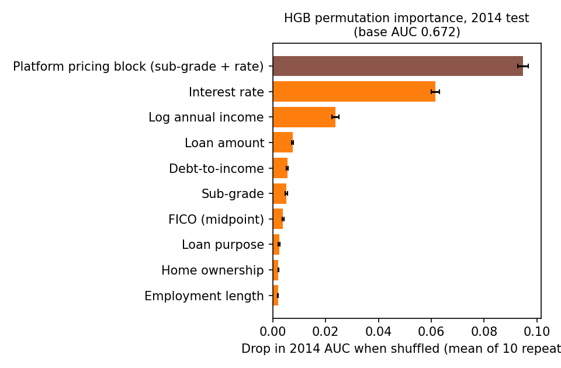

# Out-of-Time Credit Risk Prediction and Loan Selection: Does Gradient Boosting Add Value Beyond Platform Pricing and Logistic Regression?

Lucas Plaisier · AI for Finance, Final Capstone Project (Type A, Industry Focus) · 25 November 2026, corrected 26 November 2026 **[EVIDENCE NEEDED: E02]**

Code and every number in this paper: GitHub repository `lucplaisier-coder/LucPlaisier` (`python -m src.reproduce_all` reruns everything from the raw file and checks every table and figure; see Section 3.7). **[EVIDENCE NEEDED: E01]**

---

## Abstract

A note investor on Lending Club chooses which already-approved loans to fund. The platform already prices each loan through a sub-grade and an interest rate, so the question is whether machine learning finds information that this price misses. I study 611,816 finished 36-month Lending Club loans issued 2010-2015. Three selective strategies each fund 80% of the loans inside every credit grade: Lending Club's own sub-grade ranking, an L2-regularised logistic regression and histogram gradient boosting (HGB). Funding every loan is the reference. Both models use the same nine application-time inputs. They are tuned on 2013, refitted on 2010-2013 and scored once on the 2014 test year (162,570 loans), with 2015 as a robustness year. The method was frozen before any model was scored on 2014 or 2015, although earlier data audits had summarised those years' outcomes. The primary metric is the observed net cash gain per dollar invested, after an assumed 1% service fee. In 2014, HGB earns 8.01 cents per dollar, against 7.95 for the logit, 7.68 for the platform ranking and 7.74 for funding everything. The paired-bootstrap 95% intervals are +0.054 cents [+0.009, +0.100] for HGB minus logit and +0.332 cents [+0.259, +0.404] for HGB minus platform, so the pre-specified category "AI adds economic value" applies. The 2015 results fall in the same category, with smaller gains. Within the same price, income, loan size, debt-to-income and FICO help separate better from worse loans. The gain from boosting over the logit is small, about $5 per $10,000 invested.

*(Abstract: 248 words. Main text, sections 1-5 without tables, figures and captions: about 2,890 words.)*

---

## 1. Introduction and business problem

On Lending Club, individual investors buy fractions of consumer loans ("notes"). The platform screens each applicant, assigns one of 35 sub-grades (A1 to G5) with a matching interest rate, and lists the approved loans. The investor's problem is not *whether* to lend, but *which* approved, priced loans give the best money back.

The platform's price is therefore the natural benchmark. If it already contains everything that matters, machine learning adds nothing. If some borrower information is not fully priced, a model can find better and worse loans *within* the same price. Vallée and Zeng (2019) show that sophisticated investors on such platforms did screen loans beyond the platform's grade, which suggests the second case is possible. Serrano-Cinca and Gutiérrez-Nieto (2016) argue that peer-to-peer investors should judge models by profit, not by classification accuracy.

**Research question.** Among approved, listed 36-month Lending Club loans, does histogram gradient boosting, selecting loans within each credit grade, give lower charge-off rates, lower principal losses and a higher net cash gain than Lending Club's sub-grade ranking and a regularised logistic regression, on a later year not used for fitting or tuning? Funding everything is the reference.

**Financial objective.** Funding 80% of each grade, the investor wants the largest observed net cash gain per dollar invested, after the platform's service fee.

**Why these methods.** Fund-all is the naive reference and needs no model. The platform rule is the domain benchmark: inside each grade it skips the loans the platform itself prices as riskiest. Logistic regression is the classical, transparent credit-scoring model. HGB is the course's default tree ensemble and can capture non-linear effects and interactions. This ladder answers two questions: does a model beat the platform's price, and does boosting add anything over a well-built logit?

**Why select within grade.** Choosing freely, a model could "win" simply by avoiding risky grades. Funding 80% of the loans in every grade removes that shortcut: each strategy must pick loans *within* a grade. The rule fixes loan counts, not dollars, so the dollar mix can still differ slightly (Section 5).

## 2. Data

**Source.** The data is the public Kaggle copy of Lending Club's accepted-loans file (`wordsforthewise/lending-club`, `accepted_2007_to_2018Q4.csv.gz`). It has 2,260,701 rows: 2,260,668 loans and 33 summary rows. Loans were issued June 2007 to December 2018, but payment dates run to March 2019, so outcomes are observed until about then; the exact extract date is not documented. The code checks the file's SHA-256 fingerprint before and after every run and never changes or redistributes it.

**Sample.** I keep 36-month loans issued 2010-2015 under the standard credit policy, individual applications only, with a final status. The target is 1 for "Charged Off" and 0 for "Fully Paid". This drops 690 loans from 2010 that did not meet the credit policy, 239 joint applications from 2015, and 147 loans from 2015 still current or late in the data (0.05%, within the pre-set rule of at least 99% finished). The final sample has 611,816 loans (Table 1).

*Table 1. Sample by issue year. Loans = loans with a final status. Finished = share of eligible loans with a final status, before unfinished loans were dropped (2015: 282,787 of 282,934). Mean rate after the rate correction below.*

| Year | Role | Loans | Finished | Charge-off rate | Mean rate |
|---|---|---:|---:|---:|---:|
| 2010 | Training | 8,466 | 100.00% | 9.95% | 11.09% |
| 2011 | Training | 14,101 | 100.00% | 10.63% | 10.55% |
| 2012 | Training | 43,470 | 100.00% | 13.58% | 12.63% |
| 2013 | Validation (tuning) | 100,422 | 100.00% | 12.33% | 13.37% |
| 2014 | Test, scored once | 162,570 | 100.00% | 13.73% | 12.47% |
| 2015 | Robustness, scored once | 282,787 | 99.95% | 14.88% | 11.28% |

**Time split.** A random split would let the model learn from loans issued after the ones it predicts, so the split follows issue years (Table 1). This is an out-of-time validation, not a real-time backtest.

**Inputs: information shown at listing.** I kept only inputs whose field appears in the "browseNotes" sheet of Lending Club's data dictionary, which lists what investors were shown on listed loans. Nine pass (Annex A8): FICO score (midpoint of the reported range), debt-to-income, log annual income, employment length, home ownership, loan purpose, requested loan amount, and the platform's sub-grade (1 to 35) and interest rate.

The dictionary shows which kinds of information were displayed, not the exact value every investor saw. A check against dated SEC posting supplements found two small gaps in the training years: in 2010-2012 investors saw FICO in wide bands (about 20-35 points) while the file has 5-point ranges, and about 1% of checked loan amounts were reduced during listing. Checked 2013-2015 listings matched the file.

All payment, recovery and post-issue fields are excluded. `grade` only forms the selection groups. `term` is constant and `installment` follows from amount, rate and term. `verification_status` was excluded because the file does not say when a verification was completed.

**One data correction and one cash check, both decided before any model was fitted.**

* **Interest rate.** For 148 loans the stored rate differs from the listing rate in Lending Club's SEC posting supplements; 146 are stored at exactly 6.00%. That value is linked to the outcome (none of the 31 such loans from 2010-2013 charged off, against 12.4% of the rest), so it would leak post-issue information. The 148 loans were given their sourced listing rate (ledger in `decision_records/`). The cause of each discrepancy is not proven loan by loan, and the search screens were not exhaustive.
* **Cash check** (a validation, not a change). For every loan in 2010-2013, received principal, interest, late fees and recoveries add up to total payments within one cent.

**Missing values and non-stationarity.** Only employment length has gaps, growing from 3.0% (2010) to 5.9% (2014) and 6.7% (2015). The inputs drift: debt-to-income never exceeds 34.99 in the training years, but 2,253 loans in 2014 and 9,701 in 2015 lie above it, probably after a credit-policy change; in 2015, 9,651 loans are priced below the lowest training rate; and the charge-off rate moves from 9.9% (2010) to 13.7% (2014) and 14.9% (2015). These shifts are disclosed rather than capped.

## 3. Methodology

### 3.1 Four strategies

The three selective strategies fund 80% of the loans in each grade, rounded to the nearest loan. Grades F and G are merged because G has only 179 loans in 2014, below the pre-set minimum of 200.

* **A. Fund-all** funds every loan (100%) and is the reference.
* **B. Platform rule** skips the riskiest sub-grade first, then the highest rate; exact ties are broken by a seeded random number (seed 42).
* **C. Logit** and **D. HGB** skip the loans with the highest predicted probability of default (PD), using only its *ranking*; the same random number breaks ties.

### 3.2 Models and preparation

Each model sits in one scikit-learn pipeline, so all preparation is learned from the training years only.

* **Logistic regression (L2).** Missing numbers are filled with the training median and standardised. A separate unscaled 0/1 column marks missing employment length. Home ownership and purpose are one-hot encoded, and a label never seen in training becomes all zeros. The penalty C was chosen from {0.01, 0.1, 1}.
* **HGB.** Numbers go in unchanged, missing values are handled natively and the two categories use built-in categorical support. Settings: learning rate 0.05, at least 200 loans per leaf, seed 42; depth from {3, 5} and trees from {200, 500}. Early stopping is off, as fixed in the plan, so the tuned number of trees is used and no final training data is held back.

### 3.3 Tuning and validation strategy

Both models were trained on 2010-2012 and tuned on 2013 by AUC; settings within 0.002 AUC count as tied and the simpler one wins.

* **Logit:** C = 0.01 had AUC 0.665. All three values of C were within 0.001.
* **HGB:** the smallest setting, depth 3 with 200 trees, had AUC 0.665. Deeper and longer models did slightly *worse* on 2013, consistent with fitting noise.

A pre-set leakage alarm (any single input above 0.80 AUC on 2013, or a model above 0.85) did not trigger: the strongest input, the interest rate, reached 0.649. Both models were then refitted once on 2010-2013 (166,459 loans) and used to score 2014 and 2015.

### 3.4 Financial metrics

For the loans a strategy funds, using recorded cash flows:

* **Charge-off rate:** the share of funded loans that charged off.
* **Principal loss rate:** principal not recovered on charged-off loans, net of recovery costs, divided by principal funded.
* **Net cash gain per dollar (primary):** (principal + interest + late fees + recoveries − collection fees − service fee) / principal funded − 1.

The charge-off rate counts loans; the other two are dollar-weighted. The service fee is assumed at 1% of principal, interest and late fees received (0% in Annex A3).

A net cash gain of 7.74 cents means $1.0774 came back per dollar. It counts cash recorded up to the data extract and is not annualised: the data shows how much was paid, not when. For buy-and-hold loan portfolios without market prices, a Sharpe ratio, drawdowns or turnover do not apply; the relevant cost, the fee, is included.

### 3.5 Predictive metrics

AUC measures ranking, the Brier score overall probability accuracy, and the expected calibration error (ECE, 10 equal-size bins) calibration.

### 3.6 Inference and pre-specified success categories

Uncertainty comes from a **paired bootstrap**. I resample the test loans with replacement 1,000 times (seed 42), keep each strategy's funded and not-funded flags fixed, and take 95% percentile intervals of the *differences* between strategies. Pairing judges both strategies on the same resampled loans, so loans that both fund cancel in the difference. Loans are treated as independent and models as fixed (Section 5).

* **One primary metric:** net cash gain per dollar at 80%.
* **Two primary comparisons:** HGB − logit and HGB − platform.
* **Everything else is secondary**, which limits finding *something* significant by luck.

The four categories, applied to 2014 only, were fixed in the freeze record before the test:

| Category | Rule |
|---|---|
| AI adds economic value | Both primary intervals are above 0 |
| AI adds predictive but not economic value | The HGB − logit AUC interval is above 0, but at least one primary interval includes 0 |
| Simpler model preferable | The HGB − logit money interval includes 0 or is below it, and the AUC interval includes 0 |
| Platform pricing hard to beat | Neither model's money interval against the platform rule is above 0 |

### 3.7 Freeze, single test, and reproducibility

The whole method (sample, inputs, settings, selection rule, metrics, bootstrap and categories) was frozen in a signed, hashed record on 24 November 2026. According to the commit history and run logs, the test code was committed first, 2014 was then scored once and 2015 once, each run logged itself and blocks a second opening, and nothing was changed after the freeze. GitHub's own pull-request times agree with these repository records.

This does not mean the test years were never looked at. Data audits on 23 November, before any model was fitted, had computed descriptive outcomes for every year, including 2014-2015 charge-off counts, recovery shares and the fund-all net cash gain. The decision records state that these were not used to choose inputs or settings; all tuning used 2013.

The repository holds pinned package versions and every decision record. One command reruns everything from the raw file in about eight minutes and checks every table and figure against the committed version; recorded reruns passed on Python 3.12 and 3.13.

## 4. Empirical results

### 4.1 Prediction

*Table 2. Predictive performance. Final models fitted on 2010-2013; 2013 rows from the development fit.*

| Period | Model | AUC | Brier | ECE |
|---|---|---:|---:|---:|
| 2013 (tuning) | Logit | 0.665 | 0.1046 | 0.017 |
| 2013 (tuning) | HGB | 0.665 | 0.1043 | 0.014 |
| **2014 test** | Logit | 0.670 | 0.1137 | 0.012 |
| **2014 test** | HGB | 0.672 | 0.1134 | 0.014 |
| 2015 robustness | Logit | 0.678 | 0.1216 | 0.031 |
| 2015 robustness | HGB | 0.679 | 0.1217 | 0.035 |

Both models reach an AUC of about 0.67, normal for application-time credit data (the sub-grade alone: 0.649 on 2013). HGB ranks slightly better than the logit in 2014: +0.0020 AUC, interval [+0.0010, +0.0029].

Calibration worsens as the default rate rises (Figure 1). Trained on years with 12.4% charge-offs, both models predict too little risk in 2015 (14.9%). This is mainly a level shift, not a ranking failure, and selection uses only the ranking.

*Figure 1. Reliability of predicted default probabilities, 2014 and 2015.*

### 4.2 Financial result on the 2014 test (primary)

*Table 3. 2014 test, 80% within each grade, service fee 1%. Differences with paired-bootstrap 95% intervals. All six comparisons, with intervals for every metric, are in Annex A0.*

| Strategy | Loans funded | Charge-off rate | Principal loss rate | Net cash gain per $ |
|---|---:|---:|---:|---:|
| A. Fund-all | 162,570 | 13.73% | 6.69% | 7.74 c |
| B. Platform rule | 130,056 | 13.16% | 6.38% | 7.68 c |
| C. Logit | 130,056 | 12.62% | 6.24% | 7.95 c |
| D. HGB | 130,056 | **12.58%** | **6.11%** | **8.01 c** |
| **HGB − Logit (primary)** | | | | **+0.054 c [+0.009, +0.100]** |
| **HGB − Platform (primary)** | | | | **+0.332 c [+0.259, +0.404]** |
| Logit − Platform | | | | +0.278 c [+0.208, +0.349] |
| Platform − Fund-all | | | | −0.067 c [−0.134, −0.006] |

Both primary intervals lie above zero, so the pre-specified category is **"AI adds economic value"**, the only one of the four that applies (Annex A7). In money:

* **The models beat the platform's own ranking.** HGB earns 0.33 cents more per dollar than the platform rule, about $33 per $10,000 invested, and charges off 0.58 points less.
* **Boosting adds little over the logit:** 0.05 cents, about $5 per $10,000, with an interval starting close to zero. HGB's principal loss is 0.13 points lower, more than its whole gain, so other cash, mainly interest, was slightly lower; the charge-off rate is almost the same (−0.04 points, interval includes zero).
* **In 2014 the platform rule earned *less* than funding everything** (−0.07 cents): the highest-priced loans it skips paid enough extra interest to cover their extra defaults. In 2015 the difference was +0.04 cents, interval including zero (Annex A1), so this is not a general rule. A higher price within a grade did not by itself mark a worse investment, which leaves room for within-grade selection.

The strategy ranking is the same at every share from 50% to 95% (Figure 2; point estimates). HGB is at or above the logit everywhere; the gap is largest at 65-75% (0.13 cents at 70%) and smallest at 85-95%. The platform rule is below fund-all at every share, generally more so when more selective. The 80% share was fixed before the test. With a 0% fee every conclusion is unchanged (Annex A3).

*Figure 2. Net cash gain per dollar against the share of each grade funded, 2014.*

### 4.3 Robustness: a later year and grade groups

**2015.** With the same frozen models and rules (Annex A1), the order is HGB 5.48 cents, logit 5.44, platform 5.34 and fund-all 5.30. The gaps narrow:

* HGB − logit: +0.044 cents [+0.011, +0.076].
* HGB − platform: +0.139 cents [+0.081, +0.201].

The same category holds, so 2015 is consistent with 2014. All returns are lower: more loans charged off and rates were lower (Table 1).

**Grade groups (Annex A2).** Both models beat the platform rule and fund-all in grades A-B and C, which hold 82% of the 2014 loans, in both years. In the riskiest group (D-G), HGB had its largest edge in 2014 (7.99 vs 7.38 cents for the platform rule), but in 2015 the platform rule did best there (2.97 vs 2.82 cents). These are point estimates without intervals, but the edge in the riskiest loans did not carry over.

### 4.4 Error analysis: what drives the models

**Logit odds ratios** per standard deviation, holding sub-grade and rate fixed (Annex A5), show that among loans with the same price:

* higher income lowers the odds of charge-off (0.76 per SD, roughly 1.7 times the income);
* a higher FICO score lowers them (0.85 per 32 points);
* a larger loan raises them (1.12 per $7,241);
* more existing debt raises them (1.11 per 7.6 DTI points);
* employment length has practically no effect (1.01).

These are associations, not causal effects. FICO's extra effect is modest, probably because the sub-grade already reflects it.

**HGB permutation importance** (Figure 3) is the fall in 2014 AUC when one input is shuffled.

* Shuffling sub-grade and rate *together* costs 0.095 AUC, from 0.67 to about 0.58.
* Shuffled alone, the sub-grade looks unimportant (0.005), most likely because the rate carries much the same information; hence the pre-specified pricing block.
* Among borrower inputs, income matters most (0.024), followed by loan amount, debt-to-income and FICO.

*Figure 3. HGB permutation importance, 2014 test. Horizontal axis: drop in 2014 AUC when the input is shuffled (mean of 10 repeats; bars show one standard deviation).*

Both models lean mostly on the platform's price and *refine* it with a few borrower facts, income above all. On 2013 they funded 95% of the same loans (76,065 of the 80,337 each funded). Possibly, with nine inputs and the price included, little non-linear structure is left for HGB to find; this was not tested.

## 5. Conclusion and implementation risks

**Findings.** On a later year not used for fitting or tuning, machine-learning selection within grade beat Lending Club's own sub-grade ranking, and boosting added a small extra over logistic regression. The pre-specified category "AI adds economic value" applies to 2014, and 2015 is consistent. The size is modest: about $33 per $10,000 over the platform ranking and $5 over the logit in 2014, both smaller in 2015. The logit captures most of the gain with a model explained in one table.

**Limitations and deployment risks.**

* **Overfitting and selection bias** were limited by tuning on a separate year, a small grid, a pre-set tie rule and a frozen method with one test run. Earlier audits had seen test-year outcome summaries, not model results (Section 3.7). The 2010-2015 market may differ from today's.
* **Uncertainty is understated.** The bootstrap resamples single loans with fixed models, ignoring shocks shared by loans issued in the same month and refitting uncertainty. The HGB − logit interval starts at +0.009 cents and with clustered resampling might include zero, so the boosting gain is indicative, not certain.
* **Non-stationarity.** Default rates rose and inputs drifted after 2013; 2015 calibration degraded (ECE 0.031-0.035) and the edge in the riskiest grades disappeared. A live system would need regular retraining and monitoring.
* **The money measure is simplified.** It ignores payment timing, reinvestment, cash drag, taxes and secondary-market prices. It counts cash recorded up to about March 2019, and recoveries may not be final: the share of charge-offs with any recovery falls from 92% (2013) to 75% (2014) and 72% (2015), so later years may be understated. Comparing strategies on the same loans limits but does not remove this. The service fee is an assumption that leaves out any fee on recoveries; results are unchanged at 0%.
* **Dollar weights.** Equal loan counts per grade do not fix dollar weights; the size of this difference was not measured.
* **Implementation.** An investor might not have been able to buy every chosen loan, for example because faster investors funded it first or Lending Club sold it whole to institutions **[EVIDENCE NEEDED: E04]**. Lending Club stopped offering retail notes as of 31 December 2020 (LendingClub, 2021), so the exact strategy is no longer available.
* **Computational cost** is negligible on an ordinary computer.
* **Regulation and fairness.** The models use no protected characteristics, and the investor does not decide who receives credit. Still, credit models can disadvantage groups through correlated inputs (Fuster et al., 2022). A lender would face fair-lending and explainability duties, where the logit's odds ratios are easier to defend than HGB's importances.

**Bottom line.** Here the value of machine learning lies less in model complexity than in looking past the platform's price at a few borrower facts that, in these years, were linked to repayment beyond it.

---

## References

* Fuster, A., Goldsmith-Pinkham, P., Ramadorai, T., and Walther, A. (2022). Predictably unequal? The effects of machine learning on credit markets. *The Journal of Finance*, 77(1), 5-47. https://doi.org/10.1111/jofi.13090
* LendingClub Corporation (2021). Form 10-K for the fiscal year ended 31 December 2020, Item 1. SEC EDGAR: https://www.sec.gov/Archives/edgar/data/1409970/000140997021000016/lc-20201231.htm
* LendingClub Corporation. Prospectus posting supplements (Form 424B3), 2010-2015, SEC EDGAR, CIK 1409970. The 148 loans used for the rate correction, each with its filing link, are listed in `decision_records/approved_listing_rate_ledger_v1.csv`.
* LendingClub Corporation. Data dictionary `LCDataDictionary.xlsx` (sheets LoanStats and browseNotes). **[EVIDENCE NEEDED: E03]**
* Lending Club loan data: Kaggle dataset `wordsforthewise/lending-club`, https://www.kaggle.com/datasets/wordsforthewise/lending-club, file `accepted_2007_to_2018Q4.csv.gz` (SHA-256 `55c16f75…bd62a2d`).
* Pedregosa, F., et al. (2011). Scikit-learn: Machine learning in Python. *Journal of Machine Learning Research*, 12, 2825-2830. (Version used: scikit-learn 1.9.1.)
* Serrano-Cinca, C., and Gutiérrez-Nieto, B. (2016). The use of profit scoring as an alternative to credit scoring systems in peer-to-peer (P2P) lending. *Decision Support Systems*, 89, 113-122.
* Vallée, B., and Zeng, Y. (2019). Marketplace lending: A new banking paradigm? *The Review of Financial Studies*, 32(5), 1939-1982. https://doi.org/10.1093/rfs/hhy100

## Use of generative AI

Two generative AI tools were used. ChatGPT (OpenAI) was used as an adviser in the design phase, to discuss and review the research design. Claude (Anthropic) was used in four roles: (1) as an adviser reviewing the research design against the course guidelines and rubric; (2) as a coding assistant that wrote and ran the Python code under my direction; (3) to draft this manuscript from the signed-off results; and (4) to check the draft against an external review and correct its wording, without changing any analysis or result. **[EVIDENCE NEEDED: E02]** Every methodological decision was made and approved by me before the models were scored on 2014 and 2015. Each approval is recorded in `decision_records/` and in the change log of the project control document. I checked the results and remain responsible for everything submitted.

---

## Annex (not counted in the word limit)

All annex tables are copied unchanged from the saved outputs of `src/step13_final_outputs.py` (`outputs/final/`, also printed in `docs/final_tables.md`). Money is net cash gain per dollar over the loans' recorded life, service fee 1% unless stated; c = cents. Selection = 80% of loans within each grade (F and G merged). Intervals: paired bootstrap, 1,000 draws, seed 42, 95% percentile.

**Changes after the freeze (F.15).** None. No setting was changed after the methodology was frozen, and no bug fix to the test code was needed. Before the freeze, data audits computed outcome summaries for all years, including 2014 and 2015 (Section 3.7); no model results for those years existed before the freeze.

**A0. 2014 test: all six comparisons (Table 3 in full).**

| Comparison | Role | Net cash gain per $ [95%] | Charge-off rate [95%] | Principal loss [95%] |
|---|---|---|---|---|
| D. HGB minus C. Logit | primary | +0.054 c [+0.009 c, +0.100 c] | -0.04 pts [-0.11, +0.03] | -0.13 pts [-0.17, -0.09] |
| D. HGB minus B. Platform rule | primary | +0.332 c [+0.259 c, +0.404 c] | -0.58 pts [-0.70, -0.47] | -0.26 pts [-0.33, -0.20] |
| C. Logit minus B. Platform rule | secondary | +0.278 c [+0.208 c, +0.349 c] | -0.54 pts [-0.65, -0.42] | -0.14 pts [-0.20, -0.07] |
| D. HGB minus A. Fund-all | secondary | +0.265 c [+0.209 c, +0.319 c] | -1.15 pts [-1.24, -1.06] | -0.58 pts [-0.63, -0.53] |
| C. Logit minus A. Fund-all | secondary | +0.211 c [+0.158 c, +0.266 c] | -1.11 pts [-1.19, -1.02] | -0.45 pts [-0.50, -0.40] |
| B. Platform rule minus A. Fund-all | secondary | -0.067 c [-0.134 c, -0.006 c] | -0.57 pts [-0.66, -0.48] | -0.32 pts [-0.37, -0.26] |

HGB minus logit AUC: +0.0020 [+0.0010, +0.0029].

**A1. 2015 robustness (same frozen models and rules)**

| Approach | Loans funded | Charge-off rate | Principal loss rate | Net cash gain per $ | Mean rate |
|---|---|---|---|---|---|
| A. Fund-all | 282,787 | 14.88% | 7.56% | 5.30 c | 11.28% |
| B. Platform rule | 226,229 | 14.21% | 7.16% | 5.34 c | 10.95% |
| C. Logit | 226,229 | 13.89% | 7.20% | 5.44 c | 11.14% |
| D. HGB | 226,229 | 13.90% | 7.09% | 5.48 c | 11.13% |

| Comparison | Role | Net cash gain per $ [95%] | Charge-off rate [95%] | Principal loss [95%] |
|---|---|---|---|---|
| D. HGB minus C. Logit | primary | +0.044 c [+0.011 c, +0.076 c] | +0.00 pts [-0.05, +0.06] | -0.11 pts [-0.13, -0.08] |
| D. HGB minus B. Platform rule | primary | +0.139 c [+0.081 c, +0.201 c] | -0.32 pts [-0.40, -0.23] | -0.06 pts [-0.12, -0.01] |
| C. Logit minus B. Platform rule | secondary | +0.096 c [+0.034 c, +0.156 c] | -0.32 pts [-0.41, -0.24] | +0.04 pts [-0.02, +0.09] |
| D. HGB minus A. Fund-all | secondary | +0.183 c [+0.142 c, +0.225 c] | -0.99 pts [-1.06, -0.91] | -0.47 pts [-0.51, -0.43] |
| C. Logit minus A. Fund-all | secondary | +0.139 c [+0.096 c, +0.183 c] | -0.99 pts [-1.07, -0.91] | -0.36 pts [-0.40, -0.32] |
| B. Platform rule minus A. Fund-all | secondary | +0.044 c [-0.009 c, +0.093 c] | -0.67 pts [-0.74, -0.60] | -0.40 pts [-0.45, -0.35] |

HGB minus Logit AUC: +0.0010 [+0.0002, +0.0018].

**A2. Grade groups (net cash gain per $ / charge-off rate; point estimates)**

| Year | Group | A. Fund-all | B. Platform rule | C. Logit | D. HGB |
|---|---|---|---|---|---|
| 2014 | A-B | 7.64 c / 8.6% | 7.53 c / 8.0% | 7.80 c / 7.6% | 7.78 c / 7.6% |
| 2014 | C | 8.21 c / 17.2% | 8.20 c / 16.6% | 8.50 c / 15.9% | 8.54 c / 15.9% |
| 2014 | D-G | 7.38 c / 23.9% | 7.38 c / 23.4% | 7.64 c / 22.8% | 7.99 c / 22.3% |
| 2015 | A-B | 6.00 c / 9.1% | 5.96 c / 8.4% | 6.10 c / 8.2% | 6.09 c / 8.3% |
| 2015 | C | 5.21 c / 19.4% | 5.26 c / 18.8% | 5.49 c / 18.2% | 5.54 c / 18.2% |
| 2015 | D-G | 2.60 c / 28.3% | 2.97 c / 27.5% | 2.76 c / 27.2% | 2.82 c / 27.0% |

**A3. Sensitivity: service fee 0%**

| Year | Comparison | Net cash gain per $ [95%] |
|---|---|---|
| 2014 | D. HGB minus C. Logit | +0.055 c [+0.009 c, +0.102 c] |
| 2014 | D. HGB minus B. Platform rule | +0.336 c [+0.262 c, +0.408 c] |
| 2014 | C. Logit minus B. Platform rule | +0.281 c [+0.210 c, +0.352 c] |
| 2014 | D. HGB minus A. Fund-all | +0.268 c [+0.211 c, +0.322 c] |
| 2014 | C. Logit minus A. Fund-all | +0.214 c [+0.160 c, +0.269 c] |
| 2014 | B. Platform rule minus A. Fund-all | -0.068 c [-0.135 c, -0.006 c] |
| 2015 | D. HGB minus C. Logit | +0.044 c [+0.011 c, +0.077 c] |
| 2015 | D. HGB minus B. Platform rule | +0.141 c [+0.081 c, +0.203 c] |
| 2015 | C. Logit minus B. Platform rule | +0.096 c [+0.034 c, +0.157 c] |
| 2015 | D. HGB minus A. Fund-all | +0.185 c [+0.144 c, +0.227 c] |
| 2015 | C. Logit minus A. Fund-all | +0.141 c [+0.097 c, +0.185 c] |
| 2015 | B. Platform rule minus A. Fund-all | +0.045 c [-0.009 c, +0.095 c] |

**A4. Sub-grade mix of funded loans, 2014**

| Sub-grade | A. Fund-all | B. Platform rule | C. Logit | D. HGB |
|---|---|---|---|---|
| A1 | 3.2% | 4.0% | 3.9% | 3.9% |
| A2 | 3.2% | 4.0% | 3.8% | 3.8% |
| A3 | 3.6% | 4.5% | 3.9% | 4.0% |
| A4 | 5.5% | 6.9% | 5.4% | 5.5% |
| A5 | 6.2% | 2.3% | 4.8% | 4.6% |
| B1 | 5.9% | 7.3% | 7.0% | 7.2% |
| B2 | 6.3% | 7.9% | 7.1% | 7.0% |
| B3 | 7.0% | 8.7% | 7.1% | 7.3% |
| B4 | 6.8% | 8.5% | 6.2% | 6.3% |
| B5 | 6.9% | 0.4% | 5.4% | 5.1% |
| C1 | 6.3% | 7.9% | 7.2% | 7.3% |
| C2 | 6.2% | 7.7% | 6.6% | 6.9% |
| C3 | 5.5% | 6.9% | 5.5% | 5.5% |
| C4 | 4.7% | 4.5% | 4.2% | 3.9% |
| C5 | 4.4% | 0.0% | 3.5% | 3.4% |
| D1 | 3.4% | 4.3% | 3.8% | 3.8% |
| D2 | 2.9% | 3.7% | 3.1% | 3.0% |
| D3 | 2.6% | 3.2% | 2.5% | 2.6% |
| D4 | 2.1% | 1.4% | 1.9% | 1.9% |
| D5 | 1.6% | 0.0% | 1.3% | 1.4% |
| E1 | 1.4% | 1.7% | 1.5% | 1.5% |
| E2 | 1.0% | 1.3% | 1.1% | 1.1% |
| E3 | 0.8% | 0.9% | 0.7% | 0.8% |
| E4 | 0.6% | 0.4% | 0.5% | 0.5% |
| E5 | 0.6% | 0.0% | 0.5% | 0.5% |
| F1 | 0.4% | 0.5% | 0.5% | 0.5% |
| F2 | 0.2% | 0.3% | 0.2% | 0.2% |
| F3 | 0.3% | 0.4% | 0.3% | 0.3% |
| F4 | 0.2% | 0.1% | 0.1% | 0.1% |
| F5 | 0.1% | 0.0% | 0.1% | 0.1% |
| G1 | 0.1% | 0.0% | 0.0% | 0.1% |
| G2 | 0.0% | 0.0% | 0.0% | 0.0% |
| G3 | 0.0% | 0.0% | 0.0% | 0.0% |
| G4 | 0.0% | 0.0% | 0.0% | 0.0% |
| G5 | 0.0% | 0.0% | 0.0% | 0.0% |

**A5. Logit odds ratios per 1 SD (final fit 2010-2013; holding sub-grade and rate fixed)**

| Input | 1 SD | Odds ratio |
|---|---|---|
| FICO (midpoint) | 31.82 | 0.853 |
| Debt-to-income | 7.60 | 1.105 |
| Log annual income | 0.53 | 0.762 |
| Employment length | 3.50 | 1.011 |
| Loan amount | 7,241.46 | 1.122 |

**A6. All logit coefficients (final fit 2010-2013; standardised numbers; only the A5 rows are interpreted).**

| Term | Coefficient | Interpreted |
|---|---:|---|
| `num__fico_mid` | -0.15899 | yes (A5) |
| `num__dti` | 0.10011 | yes (A5) |
| `num__log_annual_inc` | -0.27123 | yes (A5) |
| `num__emp_length_ord` | 0.01132 | yes (A5) |
| `num__loan_amnt` | 0.11528 | yes (A5) |
| `num__sub_grade_ord` | 0.07928 | no |
| `num__int_rate` | 0.25963 | no |
| `missing_flag__missingindicator_emp_length_ord` | 0.26150 | no |
| `cat__home_ownership_MORTGAGE` | -0.07908 | no |
| `cat__home_ownership_NONE` | -0.00257 | no |
| `cat__home_ownership_OTHER` | 0.01503 | no |
| `cat__home_ownership_OWN` | -0.07112 | no |
| `cat__home_ownership_RENT` | 0.03707 | no |
| `cat__purpose_car` | -0.13778 | no |
| `cat__purpose_credit_card` | -0.25287 | no |
| `cat__purpose_debt_consolidation` | -0.09015 | no |
| `cat__purpose_educational` | 0.01002 | no |
| `cat__purpose_home_improvement` | 0.03321 | no |
| `cat__purpose_house` | -0.00058 | no |
| `cat__purpose_major_purchase` | -0.09357 | no |
| `cat__purpose_medical` | 0.08417 | no |
| `cat__purpose_moving` | -0.00793 | no |
| `cat__purpose_other` | 0.01356 | no |
| `cat__purpose_renewable_energy` | 0.07224 | no |
| `cat__purpose_small_business` | 0.51194 | no |
| `cat__purpose_vacation` | -0.03027 | no |
| `cat__purpose_wedding` | -0.21268 | no |
| `intercept` | -1.96927 | no |

**A7. Pre-specified success categories**

| Category (F.11) | 2014 test | 2015 (consistency only) |
|---|---|---|
| AI adds economic value | applies | applies |
| AI adds predictive but not economic value | - | - |
| Simpler model preferable | - | - |
| Platform pricing hard to beat | - | - |

**A8. Inputs: whitelist (frozen) and blacklist**

| Field | Role |
|---|---|
| fico_mid | whitelist (frozen Gate 2) |
| dti | whitelist (frozen Gate 2) |
| log_annual_inc | whitelist (frozen Gate 2) |
| emp_length_ord | whitelist (frozen Gate 2) |
| loan_amnt | whitelist (frozen Gate 2) |
| sub_grade_ord | whitelist (frozen Gate 2) |
| int_rate | whitelist (frozen Gate 2) |
| home_ownership | whitelist (frozen Gate 2) |
| purpose | whitelist (frozen Gate 2) |
| loan_status | target only |
| total_pymnt*, total_rec_*, recoveries, collection_recovery_fee | outcome (post-origination) |
| last_pymnt_*, next_pymnt_d, out_prncp*, last_credit_pull_d, last_fico_range_* | post-origination |
| pymnt_plan, hardship_*, debt_settlement_*, settlement_*, funded_amnt_inv | post-origination |
| verification_status | excluded (timing, G2-VERIFY-EXCLUDE) |
| grade | selection stratum only |
| term, installment | constant / determined by amount, rate, term |
| id, member_id, url, desc, title, emp_title, zip_code, addr_state, policy_code | identifiers, free text, location, filter |
