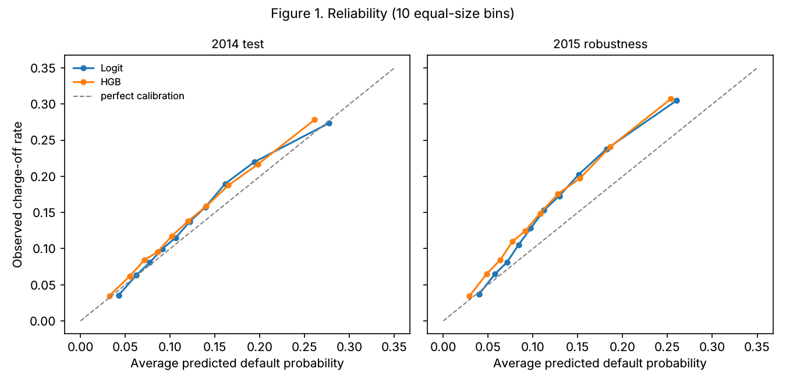
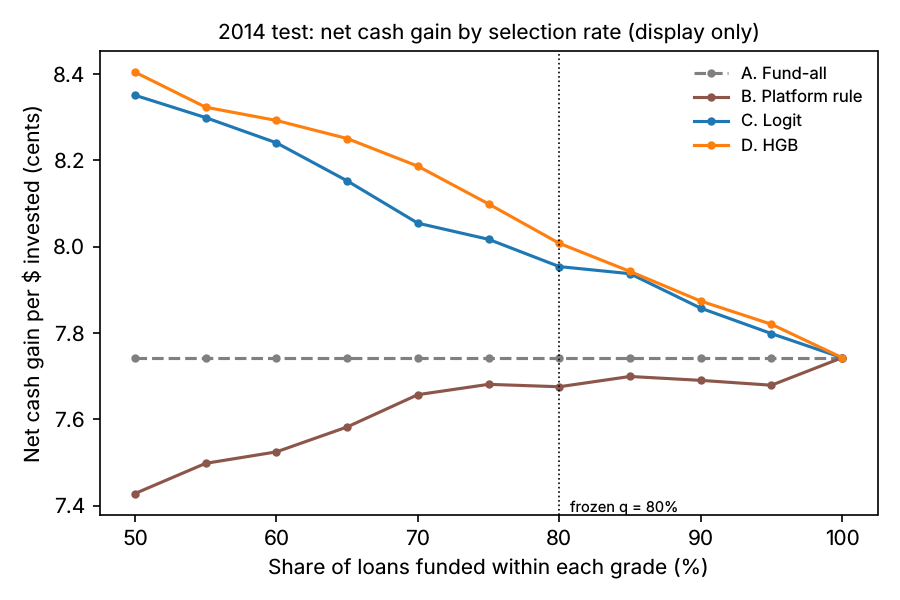

# Out-of-Time Credit Risk Prediction and Loan Selection: Does Gradient Boosting Add Value Beyond Platform Pricing and Logistic Regression?

Lucas Plaisier · AI for Finance, Final Capstone Project (Type A, Industry Focus) · 25 November 2026

Code and every number in this paper: GitHub repository `lucplaisier-coder/LucPlaisier` (`python -m src.step13_final_outputs` rebuilds all tables and figures; see Section 3.7).

---

## Abstract

A note investor on Lending Club chooses which already-approved loans to fund. The platform already prices each loan through a sub-grade and an interest rate, so the question is whether machine learning finds information that this price misses. I study 611,816 finished 36-month Lending Club loans issued 2010-2015. Four strategies are compared, each funding 80% of the loans inside every credit grade: funding everything, Lending Club's own sub-grade ranking, an L2-regularised logistic regression, and histogram gradient boosting (HGB). Both models use the same nine application-time inputs. They are tuned on 2013, refitted on 2010-2013 and scored once on an untouched 2014 test year (162,570 loans), with 2015 as a robustness year. The method was frozen before any test outcome was opened. The primary metric is the realised lifetime net cash gain per dollar invested, after a 1% service fee. In 2014, HGB earns 8.01 cents per dollar, against 7.95 for the logit, 7.68 for the platform ranking and 7.74 for funding everything. The paired-bootstrap 95% intervals are +0.054 cents [+0.009, +0.100] for HGB minus logit and +0.332 cents [+0.259, +0.404] for HGB minus platform, so the pre-registered category "AI adds economic value" applies. The 2015 results fall in the same category, with smaller gains. The models refine rather than replace the platform's price: income, loan size, debt-to-income and FICO separate better from worse loans within the same price. The gain from boosting over a well-built logit is statistically clear but economically small, about $5 per $10,000 invested.

*(Abstract: 247 words.)*

---

## 1. Introduction and business problem

On Lending Club, individual investors buy fractions of consumer loans ("notes"). The platform screens each applicant, assigns one of 35 sub-grades (A1 to G5) with a matching interest rate, and lists the approved loans for investors to fund. The investor's problem is therefore not *whether* to lend to this applicant, but *which* of the approved, priced loans give the best money back.

That makes the platform's price the natural benchmark. If the sub-grade and rate already contain everything that matters, a model can only reproduce the price, and machine learning adds nothing. If some borrower information is not fully priced, a model can find better and worse loans *within* the same price. Vallée and Zeng (2019) show that sophisticated investors on such platforms did screen loans beyond the platform's grade, which suggests the second case is possible. Serrano-Cinca and Gutiérrez-Nieto (2016) argue that peer-to-peer investors should judge models by profit, not by classification accuracy.

**Research question.** Among already-approved, listed 36-month Lending Club loans, does histogram gradient boosting, when used to select loans within each credit grade, produce lower charge-off rates, lower principal losses and a higher lifetime net cash gain than Lending Club's sub-grade ranking and a regularised logistic regression, on a later, untouched year? Funding everything is the reference.

**Financial objective.** The investor funds a fixed share of each grade (80%) and wants the largest realised net cash gain per dollar invested over the loans' life, after the platform's service fee.

**Why these methods.** I compare one simple benchmark and one machine-learning model against two naive strategies:

* **Fund-all** is the naive strategy. It needs no model.
* **The platform rule** is the domain benchmark. Inside each grade it skips the loans the platform itself prices as riskiest.
* **Logistic regression** is the classical credit-scoring model, transparent and standard in regulation.
* **HGB** is the course's default tree ensemble. It can capture non-linear effects and interactions that the logit cannot.

This ladder answers two questions: does a model beat the platform's price, and does boosting add anything over a well-built logit?

**Why select within grade.** If the strategies could choose freely, a model could "win" simply by avoiding risky grades and accepting lower interest. Holding the grade mix fixed at 80% of each grade removes that shortcut. Any gain must then come from picking better loans *within* a grade, which is the incremental information the question asks about.

## 2. Data

**Source.** The data is the public Kaggle copy of Lending Club's accepted-loans file (`wordsforthewise/lending-club`, `accepted_2007_to_2018Q4.csv.gz`, 2,260,701 loans, 151 columns, statuses as of December 2018). The code checks its SHA-256 fingerprint before and after every run. The raw file is read-only and is not redistributed.

**Sample.** I keep 36-month loans issued 2010-2015 under the standard credit policy (`policy_code` 1), individual applications only, and only loans with a final status. The target is 1 for "Charged Off" and 0 for "Fully Paid". This drops 690 loans from 2010 marked "Does not meet the credit policy", 239 joint applications from 2015, and 147 loans from 2015 that were still running in December 2018. That is 0.05% of 2015, so every year passes the pre-set rule of at least 99% finished loans. The final sample has 611,816 loans (Table 1).

**Time split.** Credit outcomes resolve years after a loan is issued. A random split would let the model learn from loans issued after the ones it predicts. So the split follows issue years:

| Role | Years | Loans |
|---|---|---:|
| Training | 2010-2012 | 66,037 |
| Validation (tuning) | 2013 | 100,422 |
| Test, opened once | 2014 | 162,570 |
| Robustness, opened once | 2015 | 282,787 |

This is an out-of-time validation, not a real-time backtest.

**Inputs: only what the investor saw at listing.** Every input had to be shown to investors when the loan was listed. I checked each one against the "browseNotes" listing fields of Lending Club's data dictionary. Nine inputs pass (Annex A8):

* the borrower's FICO score (midpoint of the reported range);
* debt-to-income ratio;
* log annual income;
* employment length;
* home ownership;
* loan purpose;
* requested loan amount;
* the platform's sub-grade (1 to 35) and interest rate.

All payment, recovery and post-issue fields are excluded. `grade` is used only to form the selection groups, because sub-grade already contains it. `term` is constant in this sample, and `installment` follows from amount, rate and term, so neither is an input. `verification_status` was also excluded: the file does not say when a verification was completed, so its value may not have been known when investors committed.

**Two data repairs, both decided before any model was fitted.**

* **Interest rate.** 148 loans carry a stored interest rate that is a later servicing rate, not the listing rate, mostly exactly 6.00%. Using it would leak post-issue information. These loans were matched to Lending Club's SEC prospectus supplements and given their listing rate. The original value is kept in an audit file.
* **Cash check.** For every loan in 2010-2013, received principal plus interest plus late fees plus recoveries equals total payments to within one cent. The cash fields can therefore be used in the money formulas.

**Missing values and non-stationarity.** Only employment length has gaps, and they grow over time: 3.0% in 2010, 5.9% in 2014 and 6.7% in 2015. The inputs also drift:

* Debt-to-income never exceeds 34.99 in the training years, but 2,253 loans in 2014 and 9,701 in 2015 lie above it. This looks like a change in Lending Club's credit policy.
* In 2015, 9,651 loans are priced below the lowest training rate.
* The default rate moves from 9.9% (2010) to 13.7% (2014) and 14.9% (2015).

These shifts are disclosed rather than capped; the riskier test years make a fair stress test.

## 3. Methodology

### 3.1 Four strategies

Each strategy funds the same number of loans in each grade: 80% of the grade, rounded to the nearest loan. Grades F and G are merged into one group because G has only 179 loans in 2014, below the pre-set minimum of 200.

* **A. Fund-all** funds every loan.
* **B. Platform rule** skips the riskiest sub-grade first, then the highest rate. Exact ties are broken by a seeded random number (seed 42).
* **C. Logit** and **D. HGB** skip the loans with the highest predicted probability of default (PD). The same random number breaks exact ties.

Selection uses only the *ranking* of loans, never the level of the PD.

### 3.2 Models and preparation

Each model sits in one scikit-learn pipeline. All preparation is learned from the training years only, so nothing from the validation or test years leaks in.

* **Logistic regression (L2).** Missing numbers are filled with the training median and standardised. A separate unscaled 0/1 column marks missing employment length. Home ownership and purpose are one-hot encoded, and a label never seen in training becomes all zeros. The penalty C was chosen from {0.01, 0.1, 1}.
* **HGB.** Numbers go in unchanged and missing values are handled natively by the trees. The two categories use HGB's built-in categorical support. The settings are learning rate 0.05, at least 200 loans per leaf and seed 42. Depth was chosen from {3, 5} and the number of trees from {200, 500}. Early stopping is switched off. A validation year cannot be reused for early stopping once it becomes part of the final training data.

### 3.3 Tuning and validation strategy

Both models were trained on 2010-2012 and tuned on 2013 by AUC. The pre-set rule is that settings within 0.002 AUC count as tied and the simpler one wins.

* **Logit:** C = 0.01 had AUC 0.665. All three values of C were within 0.001.
* **HGB:** the smallest setting, depth 3 with 200 trees, had AUC 0.665. Deeper and longer models did slightly *worse* on 2013, a typical sign of fitting noise.

A leakage alarm was set in advance: stop if any single input reaches an AUC above 0.80 on 2013, or a full model above 0.85. The strongest single input, the interest rate, reached 0.649, so the alarm did not trigger. Both models were then refitted once on 2010-2013 (166,459 loans) with the chosen settings and used to score 2014 and 2015. Nothing is learned from those years.

### 3.4 Financial metrics

For the loans a strategy funds, using the realised cash flows in the data, I compute three metrics:

* **Charge-off rate:** the share of funded loans that charged off.
* **Principal loss rate:** principal not recovered on charged-off loans, net of recovery costs, divided by principal funded.
* **Net cash gain per dollar (primary):** (principal + interest + late fees + recoveries − collection fees − service fee) / principal funded − 1.

The service fee is assumed at 1% of borrower payments, Lending Club's investor fee. A sensitivity with 0% is reported in Annex A3.

The net cash gain is a lifetime cash multiple, not an annualised return or IRR: the data shows how much was paid but not when. Each strategy is a buy-and-hold loan portfolio without market prices, so a Sharpe ratio, drawdowns or turnover do not apply. The relevant cost, the service fee, is included.

### 3.5 Predictive metrics

I report AUC for ranking, the Brier score for overall probability accuracy, and the expected calibration error (ECE). ECE is computed over 10 equal-size bins and comes with a reliability plot.

### 3.6 Inference and pre-registered success categories

Uncertainty comes from a **paired bootstrap**. I resample the test loans with replacement 1,000 times (seed 42), keep each strategy's funded and not-funded flags fixed, and take 95% percentile intervals of the *differences* between strategies. Pairing matters: shocks shared by all strategies, such as a bad economic quarter, largely cancel in a difference.

* **One primary metric:** net cash gain per dollar at 80%.
* **Two primary comparisons:** HGB − logit and HGB − platform.
* **Everything else is secondary.** Declaring this in advance limits the chance of finding *something* significant by luck.

The four categories, applied to 2014 only, were fixed before the test:

| Category | Rule |
|---|---|
| AI adds economic value | Both primary intervals are above 0 |
| AI adds predictive but not economic value | The HGB − logit AUC interval is above 0, but at least one primary interval includes 0 |
| Simpler model preferable | The HGB − logit money interval includes 0 or is below it, and the AUC interval includes 0 |
| Platform pricing hard to beat | Neither model's money interval against the platform rule is above 0 |

### 3.7 Freeze, single test, and reproducibility

The whole method was frozen in a signed record with a SHA-256 hash on 24 November 2026, while the 2014 and 2015 outcomes were still sealed. The record covers the sample, inputs, settings, selection rule, metrics, bootstrap and categories. The code made opening the sealed file possible only with that freeze date. The test code was committed before 2014 was opened. 2014 was then opened exactly once, and 2015 once afterwards. Each opening wrote a log that blocks any rerun. No setting was changed after the freeze.

The repository holds pinned package versions, the data fingerprint and every decision record, and one command per step regenerates every table and figure in this paper.

## 4. Empirical results

### 4.1 Prediction

| Period | Model | AUC | Brier | ECE |
|---|---|---:|---:|---:|
| 2013 (tuning) | Logit | 0.665 | 0.1046 | 0.017 |
| 2013 (tuning) | HGB | 0.665 | 0.1043 | 0.014 |
| **2014 test** | Logit | 0.670 | 0.1137 | 0.012 |
| **2014 test** | HGB | 0.672 | 0.1134 | 0.014 |
| 2015 robustness | Logit | 0.678 | 0.1216 | 0.031 |
| 2015 robustness | HGB | 0.679 | 0.1217 | 0.035 |

*Table 2. Predictive performance. Final models fitted on 2010-2013; 2013 rows from the development fit.*

Both models reach an AUC of about 0.67, normal for application-time credit data (the sub-grade alone: 0.649 on 2013). HGB ranks slightly better than the logit in 2014: +0.0020 AUC, interval [+0.0010, +0.0029].

Calibration worsens when the default rate rises (Figure 1). Both models were trained on years with a 12.4% charge-off rate, so they predict too little risk in 2015, when 14.9% of loans charged off. This is a level shift, not a ranking failure, and selection uses only the ranking.

*Figure 1. Reliability of predicted default probabilities, 2014 and 2015.*

### 4.2 Financial result on the 2014 test (primary)

| Strategy | Loans funded | Charge-off rate | Principal loss rate | Net cash gain per $ |
|---|---:|---:|---:|---:|
| A. Fund-all | 162,570 | 13.73% | 6.69% | 7.74 c |
| B. Platform rule | 130,056 | 13.16% | 6.38% | 7.68 c |
| C. Logit | 130,056 | 12.62% | 6.24% | 7.95 c |
| D. HGB | 130,056 | **12.58%** | **6.11%** | **8.01 c** |

| Comparison | Net cash gain per $ [95% interval] |
|---|---|
| **HGB − Logit (primary)** | **+0.054 c [+0.009, +0.100]** |
| **HGB − Platform (primary)** | **+0.332 c [+0.259, +0.404]** |
| Logit − Platform | +0.278 c [+0.208, +0.349] |
| Platform − Fund-all | −0.067 c [−0.134, −0.006] |

*Table 3. 2014 test, 80% within each grade, service fee 1%. All six comparisons are in `docs/final_tables.md`.*

Both primary intervals lie above zero, so the pre-registered category is **"AI adds economic value"**. It is the only one of the four categories that applies (Annex A7).

What the numbers mean in money:

* **The models beat the platform's own ranking.** HGB earns 0.33 cents more per dollar than the platform rule, about $33 per $10,000 invested over the loans' life. It also charges off 0.58 points less.
* **Boosting adds little over the logit.** The gain is 0.05 cents, about $5 per $10,000. It is statistically clear but economically small. Most of it comes from lower losses on the loans that did default: principal loss is 0.13 points lower, while the charge-off rate is almost the same.
* **The platform rule earns *less* than funding everything** (−0.07 cents). Inside a grade it skips the highest-priced loans, and their extra interest more than paid for their extra defaults. Inside a grade, Lending Club's finer price does not identify worse investments. This is why within-grade selection by a model can add value at all.

The result does not depend on the 80% cut-off (Figure 2). HGB is at or above the logit at every share from 50% to 100%, and the gap is largest when the investor is more selective. The platform rule falls further behind fund-all the more selective it is. The figure is for display only: the share was fixed at 80% before the test and was not chosen from this curve. With a 0% service fee every conclusion is unchanged (Annex A3).

*Figure 2. Net cash gain per dollar against the share of each grade funded, 2014.*

### 4.3 Robustness: a later year and grade groups

**2015.** The same frozen models and rules were applied to 2015 (Annex A1). The order of the strategies is HGB 5.48 cents, logit 5.44, platform 5.34 and fund-all 5.30. The gaps narrow:

* HGB − logit: +0.044 cents [+0.011, +0.076].
* HGB − platform: +0.139 cents [+0.081, +0.201].

Exactly the same category holds, so 2015 is consistent with 2014. All returns are lower because more loans charged off.

**Grade groups (Annex A2).** Both models beat the platform rule and fund-all in grades A-B and C in both years. These groups hold most of the money. In the riskiest group (D-G), HGB had its largest edge in 2014 (7.99 vs 7.38 cents for the platform rule). In 2015, however, the platform rule did best there (2.97 cents vs 2.82 for HGB). The grade-group numbers are point estimates without intervals, so small gaps should not be over-read. Still, the advantage in the riskiest loans did not carry over to the later year.

### 4.4 Error analysis: what drives the models

**Logit odds ratios** are reported per one standard deviation, holding sub-grade and rate fixed (Annex A5). Among loans with the same platform price:

* higher income lowers the odds of charge-off (0.76 per SD, roughly 1.7 times the income);
* a higher FICO score lowers them (0.85 per 32 points);
* a larger loan raises them (1.12 per $7,241);
* more existing debt raises them (1.11 per 7.6 DTI points);
* employment length has practically no effect (1.01).

FICO's extra effect is modest because the sub-grade already prices most of it.

**HGB permutation importance** on 2014 (Figure 3) measures how much the AUC falls when one input is shuffled, over 10 repeats.

* Shuffling sub-grade and rate *together* costs 0.095 AUC. That takes the model from 0.67 to about 0.58.
* Shuffled alone, the sub-grade looks unimportant (0.005), because the rate carries the same information. This is why the pricing block was pre-registered.
* Among borrower inputs, income matters most (0.024), followed by loan amount, debt-to-income and FICO.

*Figure 3. HGB permutation importance, 2014 test (drop in AUC when shuffled).*

The two methods agree: both models lean mostly on the platform's price and *refine* it with a few borrower facts the price does not fully reflect, income above all. On 2013 they funded 95% of the same loans. With nine mostly monotone inputs, there are few non-linear patterns left for HGB's flexibility to find.

## 5. Conclusion and implementation risks

**Findings.** On an untouched later year, machine-learning selection within grade beat Lending Club's own sub-grade ranking. Gradient boosting added a small but consistent extra over logistic regression. The pre-registered category "AI adds economic value" applies to 2014, and 2015 is consistent with it. The economic size is modest: about $33 per $10,000 over the platform ranking and $5 per $10,000 over the logit in 2014, both smaller in 2015. For an investor who values transparency, the logit captures most of the gain with a model that can be explained in one table.

**Limitations and deployment risks.**

* **Overfitting and selection bias.** These were controlled by tuning on a separate year, a small grid, a pre-set tie rule and a frozen method with one test run. The remaining risk is that the 2010-2015 market differs from today's.
* **Uncertainty is understated.** The bootstrap resamples single loans, so it ignores shocks shared by loans issued in the same month. The HGB − logit interval starts close to zero (+0.009 cents). With clustered resampling it might include zero, so the boosting gain should be read as indicative, not certain.
* **Non-stationarity.** Default rates rose and inputs drifted after 2013. Calibration degraded in 2015 (ECE 0.031-0.035), and the edge in the riskiest grades disappeared. A live system would need regular retraining and monitoring of the default rate.
* **The money measure is simplified.** It ignores payment timing, reinvestment, cash drag, taxes and secondary-market prices. It is a lifetime cash multiple, not an annual return. The service fee is an assumption, although results are unchanged at 0%.
* **Implementation.** In practice, attractive loans were often funded by faster investors first, and Lending Club sold some loans whole to institutions. An investor could not always buy the loans the model chose. Lending Club also closed its retail notes platform in 2020, so the exact strategy is no longer available.
* **Computational cost** is negligible: no step needs more than an ordinary computer.
* **Regulation and fairness.** The models use no protected characteristics, and the investor does not decide who receives credit. Still, models that price consumer credit can disadvantage groups through correlated inputs (Fuster et al., 2022). A lender using such a model would face fair-lending and explainability duties, and the logit's odds ratios are easier to defend there than HGB's importances.

**Bottom line.** On these application-time inputs, the value of machine learning lies less in the model's complexity than in looking past the platform's price at a few borrower facts it under-weights.

---

## References

* Fuster, A., Goldsmith-Pinkham, P., Ramadorai, T., and Walther, A. (2022). Predictably unequal? The effects of machine learning on credit markets. *The Journal of Finance*, 77(1), 5-47.
* Serrano-Cinca, C., and Gutiérrez-Nieto, B. (2016). The use of profit scoring as an alternative to credit scoring systems in peer-to-peer (P2P) lending. *Decision Support Systems*, 89, 113-122.
* Vallée, B., and Zeng, Y. (2019). Marketplace lending: A new banking paradigm? *The Review of Financial Studies*, 32(5), 1939-1982.
* Lending Club loan data: Kaggle dataset `wordsforthewise/lending-club`, file `accepted_2007_to_2018Q4.csv.gz` (SHA-256 `55c16f75…bd62a2d`).
* Pedregosa, F., et al. (2011). Scikit-learn: Machine learning in Python. *Journal of Machine Learning Research*, 12, 2825-2830.

## Use of generative AI

Two generative AI tools were used. ChatGPT (OpenAI) was used as an adviser in the design phase, to discuss and review the research design. Claude (Anthropic) was used in three roles: (1) as an adviser reviewing the research design against the course guidelines and rubric; (2) as a coding assistant that wrote and ran the Python code under my direction; and (3) to draft this manuscript from the signed-off results. Every methodological decision was made and approved by me before the test data was opened. Each approval is recorded in `decision_records/` and in the change log of the project control document. I checked the results and remain responsible for everything submitted.

---

## Annex (not counted in the word limit)

All annex tables are generated by `src/step13_final_outputs.py` and printed in full in `docs/final_tables.md`.

* **A1.** 2015 robustness: levels and all six bootstrap comparisons.
* **A2.** Grade groups A-B, C, D-G: net cash gain and charge-off rate, 2014 and 2015.
* **A3.** Sensitivity with a 0% service fee, 2014 and 2015.
* **A4.** Sub-grade mix of funded loans, 2014. The platform rule funds almost nothing from the riskiest sub-grade of each grade; the models keep loans from every sub-grade.
* **A5.** Logit odds ratios per standard deviation (borrower inputs).
* **A6.** All logit coefficients (only A5 rows are interpreted).
* **A7.** Pre-registered success categories, 2014 and 2015.
* **A8.** Input whitelist (frozen) and blacklist.

**Table 1. Sample by year.**

| Year | Role | Loans | Finished | Charge-off rate | Mean rate |
|---|---|---:|---:|---:|---:|
| 2010 | train | 8,466 | 100.00% | 9.95% | 11.09% |
| 2011 | train | 14,101 | 100.00% | 10.63% | 10.55% |
| 2012 | train | 43,470 | 100.00% | 13.58% | 12.63% |
| 2013 | validation | 100,422 | 100.00% | 12.33% | 13.37% |
| 2014 | test | 162,570 | 100.00% | 13.73% | 12.47% |
| 2015 | robustness | 282,787 | 99.95% | 14.88% | 11.28% |

**Changes after the freeze (F.15).** None. No setting was changed after the methodology was frozen, and no bug fix to the test code was needed. Before the freeze, an earlier external review had displayed a few individual loan statuses. No 2014 or 2015 outcome statistics were computed before the freeze, and this is disclosed in the step-4 decision records.
